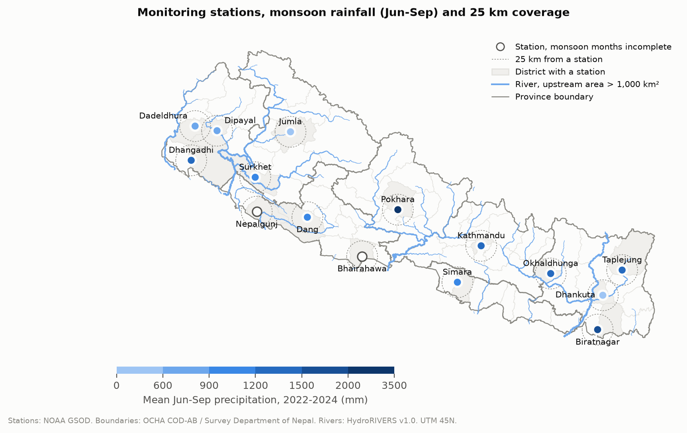
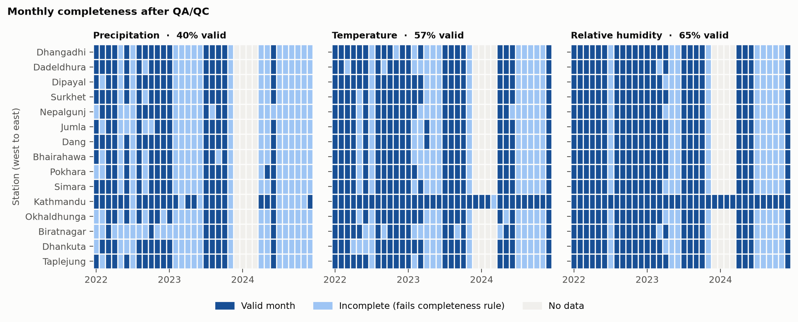
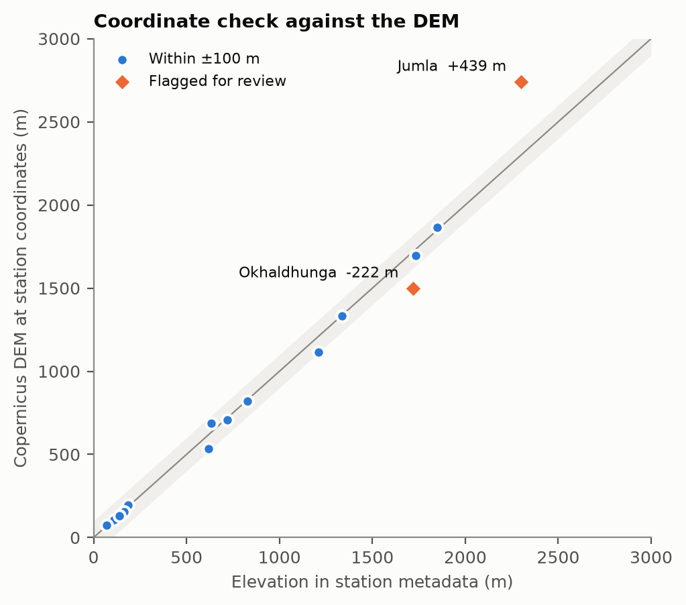
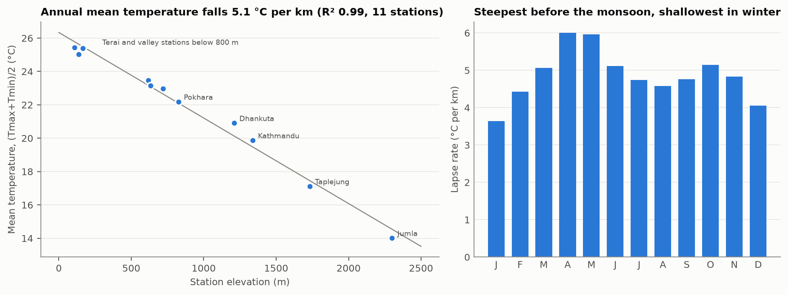
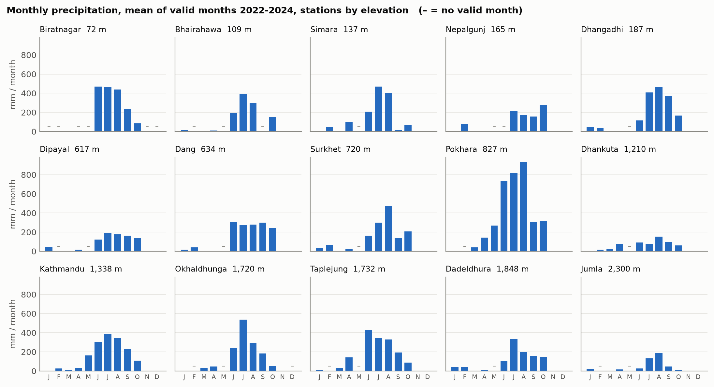
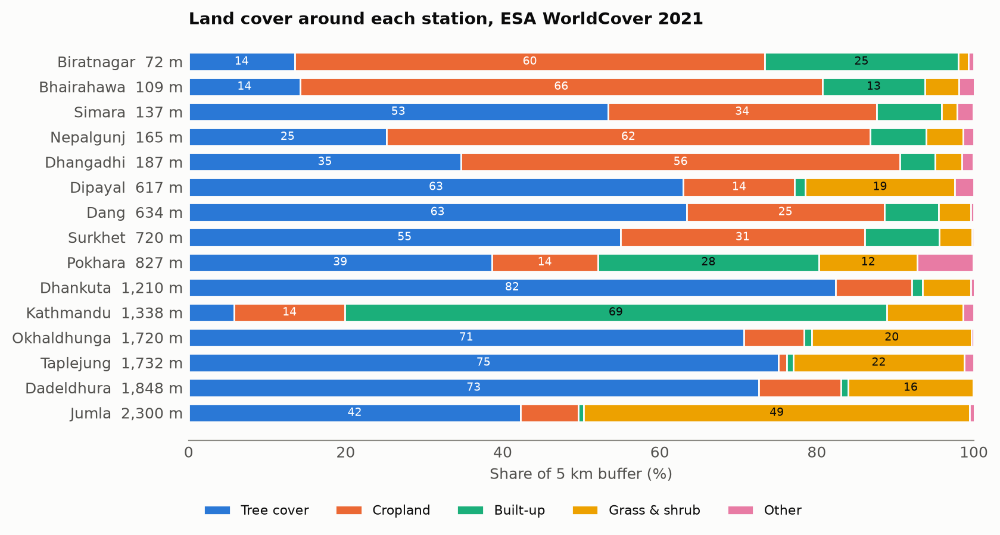

# Nepal Climate Station QA/QC and District GIS Summaries

Python (pandas, GeoPandas, rasterio, Matplotlib) · NOAA GSOD · OCHA COD-AB · Copernicus DEM · ESA WorldCover · HydroRIVERS

A reproducible QA/QC and GIS integration workflow for monthly climate station records in
Nepal: precipitation, temperature and relative humidity for 15 stations, 2022–2024. The
records are validated, standardised and aggregated to station-months, then joined to
district boundaries, elevation, land cover and rivers to produce district summaries,
maps and a documented dataset.



> **About the data.** This rebuilds, on open data, the station QA/QC and GIS workflow
> used for climate-adaptation reporting in Nepal. Station data from the Department of
> Hydrology and Meteorology is not openly downloadable, so this uses the WMO synoptic
> stations that NOAA publishes in its Global Summary of the Day. The station network,
> counts and values here are therefore not the same as those in any government report.

---

## Findings

**12,338 daily records → 1,620 station-month records → 875 valid.** 15 stations ×
36 months × 3 variables. The daily files cover 75.0% of the 16,440 possible station-days.

| Variable | Valid months | Rule a month must pass |
| --- | --- | --- |
| Precipitation | 214 of 540 (40%) | ≥ 90% of days observed |
| Temperature | 310 of 540 (57%) | WMO: ≤ 10 missing days, ≤ 4 in a row |
| Relative humidity | 351 of 540 (65%) | WMO: ≤ 10 missing days, ≤ 4 in a row |



**The gaps are network-wide, not station failures.** On 271 days none of the 14
synoptic stations outside Kathmandu has a record while Tribhuvan Airport (hourly METAR)
does, and December 2023 – March 2024 is missing at all 14. That is a transmission or
archive gap. It also means a missing value cannot be filled from a neighbouring
station, because the neighbours are missing on the same days.

**What QA/QC changed.**

| Check | Values affected | Action |
| --- | --- | --- |
| Tmin estimated by NOAA from fewer than 20 reports that day | 904 | set missing |
| Tmax estimated by NOAA from fewer than 20 reports that day | 674 | set missing |
| Precipitation flag `I`: no precipitation report that day | 148 | a 0.00 there is not an observed zero; set missing |
| Missing-value codes (9999.9, 99.99) | 75 | set missing |
| Station ID mismatch, bad or out-of-year date, duplicate station-date | 0 | — |
| Out of range, Tmin > Tmax, dew point > air temperature | 0 | — |

Every affected value is listed individually in [`data/qa_log.csv`](data/qa_log.csv).

**Daily mean temperature is (Tmax+Tmin)/2, not the mean of the reports.** Most stations
send 4–5 synoptic reports a day. Their average runs **+0.40 °C** warmer than the
max/min mean, because the reports under-sample the night.

**Two station coordinates fail the elevation check.** Ten of the 15 stations have
coordinates rounded to the whole arc-minute. Sampling the Copernicus DEM at those
positions puts **Jumla 439 m above** its recorded elevation and **Okhaldhunga 222 m
below**. Both lie in steep terrain, where a rounding error of up to ~1 km moves the
point onto a hillside. The other 13 agree within ±100 m. Both are flagged for review,
and their 5 km buffer statistics carry that uncertainty.



**The first boundary layer was rejected.** Before joining anything, both district
layers were checked (see [`data/boundary_check.csv`](data/boundary_check.csv)):

| | geoBoundaries gbOpen | OCHA COD-AB (Survey Department) |
| --- | --- | --- |
| Districts | 75 (pre-2017) | **77** |
| Duplicate names | 2 | 0 |
| Stations outside every district | 1 (Bhairahawa) | 0 |
| Airports placed in the wrong district | 1 (Pokhara, in Syangja) | 0 |

With the rejected layer, Pokhara's rainfall would have been reported for Syangja
district.

**Temperature falls 5.1 °C per km of elevation** (annual, 11 stations with all 12
months, R² 0.99). The monthly lapse rate is steepest before the monsoon (6.0 °C/km in
April) and shallowest in winter (3.6 °C/km in January).



**Monsoon rainfall varies sevenfold across the network.** June–September means range
from 397 mm at Jumla, in an inner valley of Karnali Province, to 2,794 mm at
Pokhara, directly below the Annapurna massif.



**Coverage is thin where the climate changes fastest.** 15 of 77 districts contain a
station, and 18.3% of Nepal's area lies within 25 km of one. Only one station (Jumla,
2,300 m) is above 2,000 m, while 42.4% of the country is.

**Land cover around the stations** (5 km buffers, ESA WorldCover 2021): the five Terai
stations are 56–66% cropland except Simara, which is 53% forest; Tribhuvan is 69%
built-up; most hill stations are 55–82% tree cover, the exceptions being Pokhara (28%
built-up) and Jumla (49% grass and shrub).



---

## Outputs

| File | Contents |
| --- | --- |
| `data/monthly.csv` | 1,620 station-month records: value, days observed, longest gap, status, rule |
| `data/daily_clean.csv` | QA'd daily values in SI units |
| `data/stations_gis.csv` | each station with district, province, DEM check, buffer terrain and land cover, nearest major river, climatology |
| `data/district_summary.csv` | the 15 districts with a station: area, mean elevation, station climate |
| `data/qa_log.csv`, `data/qa_summary.csv` | every flagged value and the action taken |
| `data/boundary_check.csv`, `data/coverage.csv`, `data/lapse_rate.csv` | checks and summaries above |
| `data/gis/*.gpkg` | stations, 5 km buffers, major rivers, districts with station summaries — open in QGIS or ArcGIS Pro |
| [`DATA_DICTIONARY.md`](DATA_DICTIONARY.md) | source, coverage, CRS, variables, processing and limitations of every dataset |

## Repository

```
├── fetch_data.py       downloads station, boundary and river inputs to data/raw/
├── qaqc.py             validation, unit conversion, QA flags, monthly aggregation
├── spatial_join.py     boundary check, joins, DEM, buffers, land cover, rivers, coverage
├── make_figures.py     six figures and the lapse-rate table
├── DATA_DICTIONARY.md
├── data/               processed outputs (data/raw/ is not committed)
└── figures/
```

## Reproducing

```bash
pip install pandas numpy geopandas rasterio shapely matplotlib requests
python fetch_data.py      # ~160 MB, mostly the HydroRIVERS Asia and COD boundary archives
python qaqc.py
python spatial_join.py    # reads DEM and WorldCover tiles over HTTP; ~10 minutes
python make_figures.py
```

## Method

**Stations.** Every Nepal station in NOAA's ISD station history with a record running
into 2022; all 15 have GSOD files for 2022, 2023 and 2024. Station IDs in each file are
checked against the filename and the station history, and the coordinates in the data
files against those in the station history (all agree within 0.06 km).

**Units and codes.** Temperatures converted from °F to °C, precipitation from inches
to mm. Missing-value codes replaced with blanks before any calculation.

**Relative humidity** is computed from the daily mean air and dew-point temperatures
with the Magnus formula (Alduchov & Eskridge 1996 coefficients).

**Monthly values.** Temperature and humidity use the WMO rule for monthly means.
Precipitation totals need 90% of days, because a total with missing days is biased low
and there is no reliable neighbour to fill from. Months that fail stay in the table with
their day counts and a status, so the reason a value is blank is visible.

**Climatology.** Each calendar month's value is the mean of the valid months among
2022–2024. An annual value is reported only when all 12 calendar months have one.

**GIS.** Point-in-polygon joins to COD-AB districts and provinces; Copernicus GLO-90
DEM sampled at each station and summarised over a 5 km buffer; ESA WorldCover 2021 class
shares in the same buffer at 10 m; distance to the nearest HydroRIVERS reach with
≥ 1,000 km² upstream area. Buffers and distances in UTM 45N (EPSG:32645).

## Limitations

- **Not the national network.** GSOD carries only the 15 synoptic stations that transmit
  over the WMO system; DHM runs several hundred precipitation and climate stations.
- **GSOD precipitation is assembled from synoptic messages.** Where a 24-hour report is
  missed, the value can be absent or a partial total. Totals were not checked against DHM
  gauge records, which are not openly available.
- **Humidity is from daily means** of air and dew-point temperature, not the mean of
  hourly humidity, and at most stations it reflects 4–5 reports a day.
- **Three years is not a climatology.** The monthly means describe 2022–2024 only;
  they are not normals and should not be used for trend statements.
- **Jumla and Okhaldhunga coordinates** are uncertain by up to ~1 km (see above).

## Data sources

- NOAA NCEI, Global Surface Summary of the Day (GSOD), and ISD station history.
- OCHA / Survey Department of Nepal, Nepal Subnational Administrative Boundaries
  (COD-AB), via HDX, CC BY-IGO.
- geoBoundaries gbOpen NPL ADM2 (evaluated, not used).
- ESA WorldCover 10 m 2021 v200, CC BY 4.0.
- Copernicus DEM GLO-90, © DLR e.V. 2010–2014 and © Airbus Defence and Space GmbH
  2014–2018, provided under COPERNICUS by the European Union and ESA.
- Lehner, B. & Grill, G. (2013). HydroRIVERS v1.0. *Hydrological Processes* 27(15).

## License

Code: MIT. Derived data carries the terms of its sources above.
